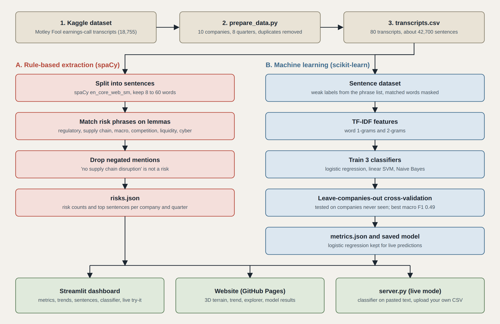

# Risk Factor Extraction from Corporate Earnings Transcripts
Risk factors from corporate earnings-call transcripts. spaCy extracts and counts risk sentences by type and quarter; a Streamlit dashboard and a scrollable 3D website show the result.

Site: enable GitHub Pages on the `/docs` folder.

## Workflow


## Layout
- `fault_lines/` extraction package (`lexicon.py`, `extract.py`, `cli.py`)
- `fault_lines/dataset.py`, `train.py` sentence dataset and classifier comparison; `models/` saved model
- `server.py` serves the website and connects it to the Python code (live classifier, CSV upload)
- `app.py` Streamlit dashboard: metrics, trends, sentence table with CSV download, CSV upload, a live "Try it" tab that runs the trained model on pasted text, and the 3D site embedded in a tab
- `docs/` website (3D terrain + write-up), reads `docs/data/risks.json`
- `data/sample_transcripts.csv` tiny made-up sample used for a quick test; `scripts/prepare_data.py` builds the real CSV
- `tests/` pytest

## Run
```
pip install -r requirements.txt
python -m spacy download en_core_web_sm
python -m fault_lines.cli          # sample data -> docs/data/risks.json
python -m fault_lines.cli --kaggle ashwinm500/earnings-call-transcripts   # real data
streamlit run app.py
cd docs && python -m http.server   # open localhost:8000
```

## Results (real data)
80 earnings-call transcripts: 10 companies (AAPL, AMZN, DIS, F, GE, GOOGL, IBM, INTC, JPM, TSLA), 8 quarters each, 42,721 sentences. 1.9% (DIS) to 7.0% (GE) of sentences mention a risk. Matches by type: macro 848, liquidity 386, supply_chain 372, regulatory 128, competition 96, cyber 49.

## Classifiers
`python -m fault_lines.dataset` builds a sentence dataset (weak labels from the lexicon, matched words masked). `python -m fault_lines.train` compares TF-IDF + logistic regression, linear SVM and Naive Bayes, scored with leave-companies-out cross-validation (the model is always tested on companies it has not seen).

Macro F1: Logistic regression 0.492, Linear SVM 0.472, Naive Bayes 0.315. Best: Logistic regression.
Per class F1: regulatory 0.183, supply_chain 0.711, macro 0.708, competition 0.269, liquidity 0.544, cyber 0.039, none 0.993.

Read these honestly: labels come from the keyword lexicon, so this measures how well context alone recovers them, not agreement with human annotators. Classes with few examples (cyber, regulatory, competition) score poorly. A hand-labelled gold set would be the next step.

## Data
Motley Fool earnings-call transcripts on Kaggle (`tpotterer/motley-fool-scraped-earnings-call-transcripts`, license unknown, cite it). The raw transcripts are not committed. Rebuild them with:
```
python scripts/prepare_data.py --pkl data/motley-fool-data.pkl   # only open pickles you trust
python -m fault_lines.cli --csv data/transcripts.csv --quarters 8
```
The Motley Fool scrape contains duplicate rows; `prepare_data.py` keeps the longest transcript per company and quarter.

## Other data
`cli.py` guesses the company, quarter and transcript columns; override them if needed:
```
python -m fault_lines.cli --csv data/real.csv --company-col <c> --quarter-col <q> --text-col <t>
```

## Limits
Extraction is rule-based (spaCy lemmas plus negation check); classifiers are trained on top (see above). It misses implied risk and counts grow with call length. Treat counts as a signal to read, not a verdict.
